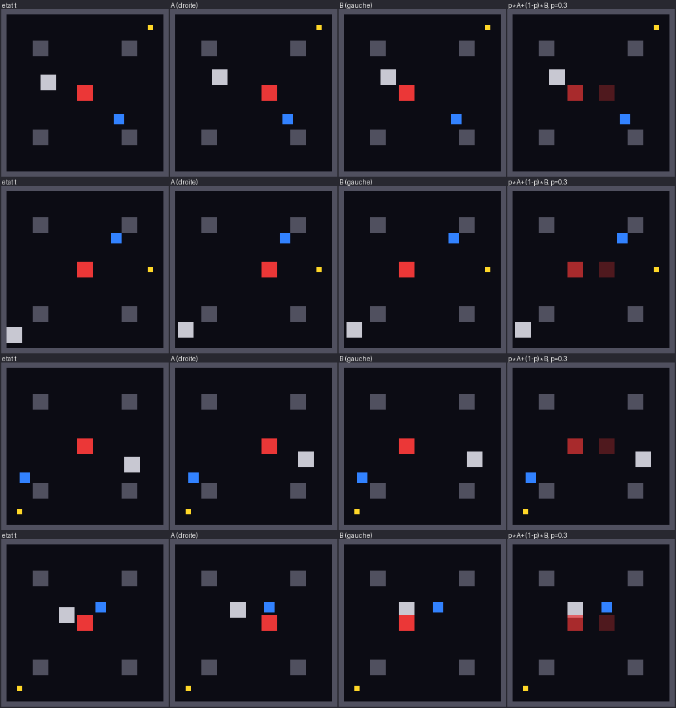
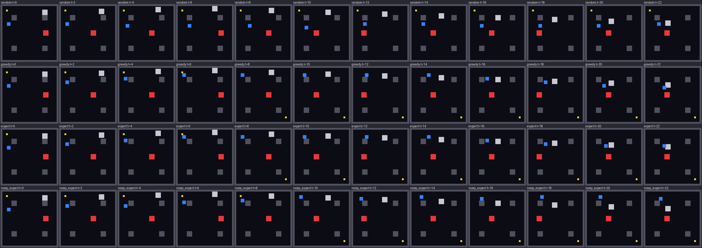

# Où naît le flou ? — un mini-jeu, des instruments de mesure et un plan d'expériences

Ce dépôt est le support du projet « Où naît le flou ? Régression, diffusion, jetons discrets ». On y trouve :

- **un petit jeu vidéo** (64 × 64 pixels) dont on connaît *exactement* la loi du hasard, et auquel on peut jouer au clavier ;
- **quatre bots** qui y jouent, et de quoi fabriquer des jeux de données reproductibles ;
- **les instruments de mesure** (comment classer une image prédite en « nette » ou « floue ») et la chaîne d'analyse ;
- **le code de trois familles de modèles** (régression, diffusion, jetons discrets) avec un plan de 25 entraînements ;
- **une extension « décision »** : le flou fausse-t-il l'estimation d'un risque, et coûte-t-il des points à un agent qui planifie
  en se servant du modèle comme simulateur ? (§4.1)

La question scientifique : quand le futur d'une scène peut prendre deux formes, un modèle qui prédit l'image suivante
la prédit-il floue (une moyenne des deux), nette mais fausse, ou nette *et* bien répartie entre les deux ? Le jeu sert à poser
cette question avec une réponse exacte connue d'avance (§1.5 et §4).

> **État honnête.** Tout ce qui est en NumPy est exécuté et testé (272 tests). Le code PyTorch des modèles et de l'entraînement
> a tourné sur Tesla T4 (Kaggle) : test de fumée entièrement `[OK]`, et 5 des 12 entraînements prioritaires sont terminés et
> évalués (régression s0 et s1, diffusion s0 et s1, jetons s0). **Aucune hypothèse comparant les familles n'est encore
> tranchée** : H1 à H3 exigent les trois familles sur trois graines. Le récit des incidents est dans `docs/JOURNAL.md` ;
> certains passages du §5 décrivent encore l'état d'avant le premier entraînement.



*Quatre exemples, une ligne chacun. De gauche à droite : l'état à l'instant t (l'ennemi rouge est au centre de son rail), les deux
images possibles au pas suivant (il part à droite = A, ou à gauche = B), et le mélange `p·A + (1−p)·B` pour p = 0,3 : c'est ce que
prédit un modèle entraîné à minimiser l'erreur quadratique, une image floue qui n'est ni A ni B.*

## Par où commencer

| Je veux… | Je lance | Il me faut |
|---|---|---|
| **jouer** au jeu | `uv run scripts/play.py` | uv (§2) |
| regarder un bot jouer | `uv run scripts/play.py --bot expert` | idem |
| vérifier que tout marche | `make test` (ou `uv run pytest`) | idem (`uv sync` installe aussi pytest, SciPy, Pillow, Matplotlib) |
| voir toute la chaîne d'analyse tourner, **sans GPU** | `make dry-run` | idem |
| voir un agent planifier dans un « modèle » (ici le vrai jeu) | `make validate-decision` | idem |
| entraîner et mesurer pour de vrai | §3.6 | un GPU et `uv sync --extra train` (Colab T4 convient) |

**Première fois :** installer [uv](https://docs.astral.sh/uv/getting-started/installation/), puis `cd flou_wm && uv sync` (§2).
Le mode d'emploi complet, étape par étape, est au **§3**. Le principe du jeu est au **§1**.

## 1. Le jeu : principe

### 1.1 En une phrase

Vous pilotez un petit carré bleu dans une arène vue de dessus. Vous ramassez un petit objet jaune sans toucher un ennemi rouge
qui fait des allers-retours ; **à chaque passage au milieu de son rail, l'ennemi choisit au hasard de repartir à droite ou à
gauche**. Ce hasard est la seule source d'incertitude du jeu, et c'est tout l'intérêt du projet.

### 1.2 Ce qu'on voit

Une image de 64 × 64 pixels : un mur d'enceinte, quatre piliers, et cinq sortes d'objets.

| Objet | Aspect | Ce qu'il fait |
|---|---|---|
| **Agent** | carré bleu 4 × 4 | c'est vous ; il avance de 2 pixels par pas dans la direction choisie |
| **Petit objet** | carré jaune 2 × 2 | à ramasser (+1). Une fois pris, il réapparaît à l'emplacement le plus éloigné de vous |
| **Ennemi** | carré rouge 6 × 6 | va et vient sur un rail horizontal, 6 pixels par pas (trois fois plus vite que vous) ; **bifurque au centre** |
| **Obstacle** | carré gris clair 6 × 6 | rebondit sur les murs de façon prévisible ; vous bloque si vous poussez contre lui |
| **Murs et piliers** | gris sombre | arrêtent l'agent et font rebondir l'obstacle |



*Les mêmes premiers pas (t = 0 à 22, une image tous les 2 pas) joués par quatre bots. Bleu : agent ; rouge : ennemi ; gris clair : obstacle ;
jaune : petit objet.*

### 1.3 But et commandes

- **But** : ramasser le petit objet jaune (**+1** à chaque fois) sans toucher l'ennemi (**−1** à chaque contact). Une partie dure
  **100 pas** ; le score est ramassages − contacts.
- **Au tour par tour** : *une touche = un pas*. L'ennemi et l'obstacle avancent même si vous ne faites rien.
- **Touches** : flèches ou `Z Q S D` / `W A S D` pour se déplacer, **espace** pour ne rien faire, `r` pour recommencer, `x` pour quitter.
- **Sous l'image**, un bandeau affiche : la valeur de p, le pas courant (sur 100), vos ramassages, vos contacts et le score ; ce qui
  s'est passé au pas précédent (dont **le côté choisi par l'ennemi** quand il a bifurqué) ; et où est l'ennemi. Quand il est **au centre
  de son rail**, le bandeau l'annonce et rappelle les probabilités du prochain tirage : c'est le moment de la bifurcation.

### 1.4 Ce qui se passe à chaque pas

Dans cet ordre : (1) l'agent se déplace, sauf s'il est bloqué par un mur, un pilier ou l'obstacle ; (2) l'obstacle avance et
rebondit ; (3) l'ennemi avance sur son rail et, **s'il est au centre, la branche décide où il part** ; (4) on compte ramassage et
contact ; (5) si le petit objet a été pris, il réapparaît. Tout est déterministe **sauf** l'étape (3) : c'est ce qui permet de
mesurer proprement l'effet du hasard et d'aucun autre. Règles exactes : [`docs/GAME_SPEC.md`](docs/GAME_SPEC.md).

### 1.5 La bifurcation : le cœur du projet

L'ennemi parcourt un rail de sept positions (−3 à +3, une position par pas) et fait demi-tour au bout de chaque bras :

```
 position de l'ennemi :   -3    -2    -1     0    +1    +2    +3
                           ●─────●─────●─────◆─────●─────●─────●
                                             ▲
                  bifurcation : vers +1 (branche A) avec la probabilité p,
                                vers -1 (branche B) avec la probabilité 1 - p
```

Un cycle dure **6 pas** : du centre jusqu'au bout d'un bras (3 pas), demi-tour, retour au centre (3 pas), où l'ennemi **bifurque de
nouveau**, sans se souvenir de son choix précédent. Donc **un état sur six est un « état de bifurcation »**, quoi que fasse le joueur. À un tel état, le jeu tire la branche, et les deux images possibles du pas
suivant **ne diffèrent que par la position de l'ennemi** (12 pixels plus à gauche ou plus à droite). Ce sont les deux images
« contrefactuelles » A et B de l'illustration ci-dessus.

`p` est un réglage : p = 0,5 pour un pile ou face, p = 0,3 pour le cœur du plan d'expériences, p = 0 pour que l'ennemi parte toujours à gauche (plus aucune incertitude : cas de contrôle).

### 1.6 Pourquoi un jeu aussi simple

Un réseau qui prédit l'image suivante en minimisant l'erreur quadratique (une **régression**) apprend la *moyenne* des futurs
possibles. Ici, c'est `p·A + (1−p)·B` : deux ennemis fantômes, l'un plus clair que l'autre. Cette image n'existe dans aucun
futur réel, c'est **le flou**. Un modèle qui **tire** au hasard un futur (diffusion, jetons discrets) peut produire des images
nettes — mais reproduit-il la bonne fréquence p ? garde-t-il le petit jaune de 2 × 2 pixels ? C'est ce que le projet mesure, et
comme A, B et p sont connus exactement, chaque prédiction se **classe** : nette-A, nette-B, floue, ou « autre » (§4 et
[`docs/EXPERIMENTS.md`](docs/EXPERIMENTS.md)).

Limites assumées du jeu : le lieu et le rythme de la bifurcation sont prévisibles (seule l'issue ne l'est pas), et l'ennemi
n'agit pas sur le reste du monde. Le jeu isole le phénomène étudié mais ne dit rien de dynamiques où la bifurcation changerait la
suite de la partie.

### 1.7 Propriétés du jeu qui comptent pour les mesures

- **Un état sur six est un état de bifurcation** (l'ennemi est au centre de son rail), quel que
  soit le bot (le cours propose au moins 5 %).
- **La branche est tirée à l'instant t et n'apparaît dans l'image qu'en t + 1.** Elle n'est pas
  dans l'état ; les tests vérifient sa fréquence (= p) et son indépendance d'un tirage au suivant.
- **Aux états de bifurcation, les deux futurs ne diffèrent que par l'ennemi**, 12 pixels plus à
  gauche ou à droite (le cours propose au moins 8). `δ = ||A − B|| ≈ 7,65`.
- **Rendu et dynamique sont des fonctions pures** : `advance(état, action, branche)` et
  `render(état)`. Forcer la branche donne les images contrefactuelles A et B.
- **L'état exact est exposé** (positions, vitesses, branche choisie) avec des drapeaux
  d'événements : blocage, contact avec l'ennemi ou l'obstacle, rebond en x ou en y, ramassage.
  C'est ce qui rendra possibles la sonde de position et l'analyse d'erreurs.

Règles complètes, disposition de l'état et limites : [`docs/GAME_SPEC.md`](docs/GAME_SPEC.md).

## 2. Installation

Le projet est géré avec **[uv](https://docs.astral.sh/uv/)** : un seul outil qui installe Python si besoin, crée l'environnement `.venv`
et y installe les dépendances déclarées dans `pyproject.toml`. Si uv n'est pas installé : [guide d'installation](https://docs.astral.sh/uv/getting-started/installation/).
Python **≥ 3.10** est requis (uv peut le télécharger lui-même).

```bash
cd flou_wm
uv sync                       # crée .venv et installe tout sauf PyTorch (et écrit uv.lock la première fois)
uv run scripts/play.py        # `uv run` lance la commande dans cet environnement ; c'est tout
```

Ce que `uv sync` installe, et pourquoi :

| Paquets | Rôle | Où c'est déclaré |
|---|---|---|
| NumPy, SciPy | jeu, bots, données (NumPy) ; instruments et analyse (SciPy) | `dependencies` |
| pytest | les tests | groupe `dev` (installé par défaut) |
| Pillow, Matplotlib | planches d'images et figures | groupe `viz` (installé par défaut) |
| **PyTorch** | **seulement pour entraîner** les modèles | extra `train` (jamais installé par défaut) |
| Gymnasium | enveloppe facultative du jeu | extra `gym` |

**Machine d'entraînement (GPU).** Ajouter PyTorch avec l'extra `train` :

```bash
uv sync --extra train         # (ou : make sync-train)
uv run scripts/smoke_test.py --time
```

> **Piège à connaître.** `uv sync` est « exact » : il **désinstalle** tout ce qui n'est pas demandé. Sur la machine d'entraînement, un
> `uv sync` nu supprimerait donc PyTorch ; il faut alors relancer `uv sync --extra train`. À l'inverse, `uv run` ne désinstalle rien :
> `uv run scripts/train.py ...` conserve PyTorch une fois installé. En cas de doute : `make sync-train`.

**Version de PyTorch (CPU ou CUDA).** Par défaut, `torch` vient de PyPI : roue CUDA sous Linux, roue CPU sous Windows et macOS, ce qui convient
à une machine GPU Linux ordinaire. Pour forcer la roue CPU (plus légère) ou une version CUDA précise, un bloc prêt à décommenter est
au bas de `pyproject.toml` ; le guide d'uv est <https://docs.astral.sh/uv/guides/integration/pytorch/>. Si PyTorch n'a pas encore de roue pour
votre version de Python (cas d'un Python très récent), choisir une version plus ancienne : `uv sync --extra train --python 3.12`.

**Hors ligne ou sur une machine sans accès à PyPI** : `uv run --offline ...` (ou `--no-sync` si l'environnement est déjà installé).

**Sans uv.** Le paquet n'a pas besoin d'être installé : les scripts s'exécutent depuis la racine du dépôt (`scripts/_bootstrap.py` ajoute
`src/` au chemin de Python). Avec pip :

```bash
python -m venv .venv && source .venv/bin/activate       # Windows : .venv\Scripts\activate
pip install -r requirements.txt                         # numpy, scipy, pillow, matplotlib, pytest
pip install torch                                       # seulement pour entraîner (GPU : voir https://pytorch.org)
python scripts/play.py                                  # puis, partout dans ce README, « uv run X » devient « python X »
python -m pytest                                        # et « uv run pytest » devient « python -m pytest »
```

NumPy suffit pour **jouer, regarder un bot et générer des données** (vérifié sans SciPy) ; SciPy sert aux instruments et à l'analyse.
Sur Colab, PyTorch est déjà installé : le notebook utilise pip (voir `notebooks/README.md`).

**Ce qui a été vérifié.** Le `pyproject.toml` a d'abord été testé avec uv 0.11 **hors ligne**, sur un index de roues local (les paquets installés sur la
machine de développement, plus de fausses roues `torch` et `gymnasium`) : `uv lock`, `uv sync`, `uv sync --extra train`, le comportement
exact/inexact décrit ci-dessus, `uv run scripts/play.py` dans un pseudo-terminal, la suite de tests lancée par `uv run pytest`, et le `Makefile` avec et sans uv.
Depuis, la **vraie résolution PyPI** a eu lieu (uv 0.11.2, Windows 11, Python 3.12) : `uv sync` a téléchargé et installé NumPy, SciPy,
Pillow, Matplotlib et pytest depuis PyPI, et la suite de tests passe dans cet environnement.
**Pas testé** : l'installation de la vraie PyTorch (`uv sync --extra train`, jamais lancé) et macOS.
**`uv.lock` est fourni et versionné** : il fige les versions exactes (83 paquets, PyTorch compris) ; `uv lock` le rafraîchit.
Si une résolution échoue (PyTorch ou autre), copier le message d'erreur : c'est `pyproject.toml` qu'il faut alors corriger.

Le `Makefile` n'est qu'un raccourci : chaque cible a son équivalent en `uv run ...` (tableau du §3). Il détecte uv tout seul ; sans uv, ou pour
utiliser un autre interpréteur : `make test PY=python`. Sous Windows (sans `make`), utiliser directement les commandes `uv run`.

## 3. Lancer le projet pas à pas

Toutes les commandes se lancent **depuis la racine du dépôt** (le dossier qui contient `README.md`), après `uv sync` (§2).
`uv run X` lance `X` dans l'environnement du projet, qu'il met à jour au besoin ; sans uv, remplacer `uv run scripts/…` par `python scripts/…`
et `uv run pytest` par `python -m pytest` (§2).

**Sous Windows, préfixer toutes ces commandes par `PYTHONUTF8=1`** (PowerShell : `$env:PYTHONUTF8=1` une fois par session). Sans cela,
Python écrit sa sortie en `cp1252` et les scripts qui affichent des accents, `δ`, `ρ` ou les cadres du jeu plantent sur un
`UnicodeEncodeError` (§3.8) : c'est vérifié pour `play.py`, `validate_instrument.py`, `validate_decision.py`, `human_review.py` et
`pytest`. Les rapports JSON sont écrits **avant** l'affichage, donc une exécution qui plante ainsi n'a rien perdu — mais elle sort
avec un code non nul, ce qui ressemble à tort à un contrôle échoué.

| Étape | Avec `make` | Commande (sans `make`) | Où | Durée mesurée | Ce que ça produit |
|---|---|---|---|---|---|
| 3.1 Jouer | `make play` | `uv run scripts/play.py` | CPU | — | une partie dans le terminal |
| 3.2 Tester | `make test` | `uv run pytest` | CPU | ≈ 3,5 min | 272 tests (2 ignorés ici : Gymnasium absent, pseudo-terminal) |
| 3.3 Données | `make data` | voir 3.3 | CPU | 2 s | `data/p*/` : entraînement, validation, test |
| 3.4 Instrument | `make validate` | `uv run scripts/validate_instrument.py` | CPU | 53 s | `reports/instrument.json` : ρmax et contrôle H0a |
| 3.4 bis Extension « décision » | `make validate-decision` | `uv run scripts/validate_decision.py` | CPU | 5 à 15 min | `reports/decision_instrument.json` : contrôles H0e et H0f |
| 3.5 Répétition générale | `make dry-run` | `uv run scripts/dry_run.py` | CPU | ≈ 5 min | rapport **simulé** dans `reports/dryrun/` |
| 3.6 Entraînement réel | `make smoke` puis voir 3.6 | `uv run scripts/smoke_test.py --time` | **GPU** | *non mesuré* | `runs/`, `reports/` |

Durées mesurées sur une machine à 2 cœurs, sans GPU ; elles varient d'une machine à l'autre.

### 3.1 Jouer

```bash
uv run scripts/play.py                    # vous jouez : flèches ou ZQSD / WASD ; espace = ne rien faire ; r = recommencer ; x = quitter
uv run scripts/play.py --p 0.5 --seed 3   # l'ennemi bifurque à pile ou face ; partie reproductible
uv run scripts/play.py --bot expert       # regarder un bot jouer (Ctrl-C pour arrêter) ; bots : random, greedy, expert, noisy_expert
uv run scripts/play.py --colors 256       # si les couleurs sont fausses (Terminal.app de macOS, par exemple)
```

Il faut un terminal d'au moins **64 colonnes × 40 lignes**. Sous Windows, utiliser Windows Terminal ; si les touches ne répondent pas,
taper des lettres puis Entrée fonctionne aussi (par exemple `ddss`). Principe et touches : §1.3.
Pour voir des images au lieu du terminal : `make demo` écrit `docs/img/*.png` (demande Pillow).

### 3.2 Vérifier que tout est en ordre

```bash
uv run pytest                             # tous les tests (≈ 3,5 min, dont environ une minute de préparation de runs simulés)
uv run pytest tests/test_dynamics.py      # un seul fichier, quelques secondes
uv run scripts/lint_names.py src scripts tests    # vérification statique des noms (le code PyTorch n'étant pas exécutable ici)
```

### 3.3 Fabriquer les données

On stocke des **états**, pas des images (le rendu se recalcule à la lecture) : les fichiers sont petits.

```bash
make data          # équivaut aux trois lignes suivantes, pour p = 0 ; 0,1 ; 0,3 ; 0,5
uv run scripts/generate_data.py --split train --p 0.0 0.1 0.3 0.5 --n-transitions 400000
uv run scripts/generate_data.py --split val   --p 0.0 0.1 0.3 0.5 --n-transitions 20000
uv run scripts/generate_data.py --split test  --p 0.0 0.1 0.3 0.5 --n-bifurcations 2000
```

`p = 0` sert aux contrôles du plan. Le jeu de **test** contient 2 000 états de bifurcation figés, communs à tous les modèles. Détails au §7.

**Pourquoi 2 000 et non 1 000.** H2b exige au moins 1 000 images **nettes** par graine. Avec 1 000 états et une prédiction par état, ce plafond n'était atteignable que si aucune image n'était floue ni « autre » : le verdict était « non concluant » d'office. Changer ce nombre modifie ρmax, calculé sur les jeux de test : relancer `validate_instrument.py` et revérifier H0a avant toute évaluation, et évaluer tous les runs avec le même ρmax.

**Pourquoi 400 000 et non 100 000.** Le premier run réel, mené à 100 000 transitions, a échoué au contrôle H0b :
à 34 800 pas en lot 64, le modèle voyait 22 fois les mêmes données et a mémorisé l'issue de chaque bifurcation au lieu
d'apprendre à produire le mélange. Diagnostic complet et chiffré dans [`docs/JOURNAL.md`](docs/JOURNAL.md) (J6). À 400 000,
le nombre de passages tombe à 5,6. La validation et le test restent inchangés : leurs flux aléatoires sont indépendants.

### 3.4 Valider l'instrument (avant de mesurer le moindre modèle)

```bash
uv run scripts/validate_instrument.py      # écrit reports/instrument.json
```

Règle le seuil ρmax du classifieur et vérifie, **sans aucun entraînement**, qu'il classe correctement des images dont on connaît la
bonne réponse (contrôle **H0a**). Si H0a échoue, la commande s'arrête avec un code non nul : on ne mesure aucun modèle avant de comprendre
pourquoi. Avec peu d'états de test l'échec peut être un faux négatif statistique (le script le signale sous 600 paires ; voir
[`docs/EXPERIMENTS.md`](docs/EXPERIMENTS.md) §3).

### 3.4 bis Valider l'extension « décision » (sans GPU)

```bash
uv run scripts/validate_decision.py                # 5 min (2 cœurs Linux) à 14 min (Windows 11, Python 3.12) ; --no-planner : quelques secondes
```

Crée le jeu de test du niveau 1 (`data/p0.30/test_decision.npz`, 3 000 états), vérifie que le **lecteur de contact** retrouve
l'événement du jeu sur de vraies images (contrôle **H0e**), affiche l'erreur attendue « si les modèles étaient parfaits », puis fait
jouer 50 parties à un **planificateur qui utilise le vrai jeu comme modèle** (contrôle **H0f**, d'après la référence « vrai simulateur »
de PlaNet, arXiv:1811.04551, Table 1). Définitions, hypothèses H4 et H5 et articles qui les guident :
[`docs/EXTENSION_DECISION.md`](docs/EXTENSION_DECISION.md).

**Sous Windows, lancer `PYTHONUTF8=1 uv run scripts/validate_decision.py`** : sans ce réglage le script écrit bien son rapport, puis
plante en l'affichant (`UnicodeEncodeError`, §3.8) et sort avec un code non nul, ce qui ressemble à tort à un contrôle échoué.

### 3.5 Répétition générale sans GPU (résultats **simulés**)

```bash
uv run scripts/dry_run.py                  # 25 runs fictifs + toute l'analyse
uv run scripts/dry_run.py --states 300     # plus rapide
```

Des « modèles » factices dont on connaît le comportement (un régresseur idéal, un échantillonneur parfait, un oracle…) sont évalués par
le vrai évaluateur, puis le vrai script d'analyse tourne. **Tout est écrit sous « SIMULATION »** dans `data_dryrun/`, `runs_dryrun/` et
`reports/dryrun/` (les trois sont ignorés par git) ; **ces chiffres ne mesurent aucun modèle**, ils vérifient que la chaîne reconnaît les effets qu'on y a plantés.
Ouvrir `reports/dryrun/report.md` (verdicts H0–H5, tables, figures `fig_*.png`) pour voir à quoi ressemblera le rapport final.
La répétition couvre aussi l'extension « décision » (`--no-decision` pour l'omettre).
Le script d'analyse refuse d'écrire des runs simulés dans `reports/`, réservé aux vrais résultats.

### 3.6 Entraînement réel (GPU requis)

**Sur Kaggle (la voie retenue).** Ouvrir `notebooks/flou_kaggle.ipynb` sur Kaggle, régler l'accélérateur sur *GPU T4 x2*,
activer *Internet On*, attacher le Dataset privé `flou-wm-etat` à sa dernière version, puis lancer **Save & Run All
(Commit)**. La session tourne en arrière-plan, machine éteinte, 12 h au plus ; l'état (`runs/`, `reports/`) est repris du
Dataset au début et republié à la fin, si bien que l'entraînement reprend au dernier checkpoint d'une session à l'autre.
La variable `STAGE` de la première cellule choisit ce que fait la session. Voir `docs/JOURNAL.md`, J8.

**Sur Colab.** `notebooks/flou_colab.ipynb` fait la même chose en gardant les résultats sur Google Drive, mais le runtime
est libéré dès que la fenêtre se ferme ou que la machine se met en veille (sauf abonnement Pro+). Utile pour une
vérification courte, pas pour la campagne.

**Sur une machine à GPU.** Installer PyTorch avec l'extra `train` (§2), puis, dans l'ordre :

```bash
uv sync --extra train                      # 0. une fois : environnement + PyTorch (ne pas relancer un `uv sync` nu ensuite, §2)
uv run scripts/smoke_test.py --time        # 1. OBLIGATOIRE : fait tourner tout le code PyTorch sur de minuscules données,
                                           #    dit ce qui casse, mesure le temps par pas -> reports/timing.json
make data                                  # 2. données (3.3)
uv run scripts/validate_instrument.py      # 3. l'instrument doit passer H0a (3.4)
uv run scripts/plan.py --timing reports/timing.json --budget-hours 38   # 4. nombre de pas par run qui tient dans le budget
uv run scripts/run_plan.py --steps 20000   # 5. les 25 entraînements puis leurs évaluations (remplacer 20000 par la valeur de l'étape 4)
uv run scripts/analyze.py                  # 6. verdicts H0–H3, tables, figures -> reports/report.md
# extension « décision » (facultative, après l'étape 5 ; voir docs/EXTENSION_DECISION.md)
uv run scripts/validate_decision.py        # 7. contrôles H0e et H0f (sans GPU, ≈ 5 min)
uv run scripts/evaluate_decision.py --all  # 8. niveau 1 (H4) : rapide
uv run scripts/evaluate_decision.py --all --level 2   # 9. niveau 2 (H5) : LONG, durée estimée par l'étape 1 et affichée en route
uv run scripts/analyze.py                  # 10. le rapport contient alors aussi H4 et H5
```

À savoir :
- **Pourquoi le test de fumée d'abord.** Le code PyTorch n'a jamais tourné : il faut s'attendre à quelques erreurs de forme ou d'API à
  la première exécution ; ce script les révèle en quelques minutes plutôt qu'après une heure d'entraînement.
- **Reprendre après une coupure** : relancer **la même commande**. Les entraînements reprennent au dernier checkpoint, les runs
  terminés ne sont pas refaits.
- **Ordre de priorité** : cœur (9 runs) et contrôles (3) d'abord, puis axe K (6), grille (1), axe p (6, sacrifié en premier).
  Options utiles de `run_plan.py` : `--groups core control`, `--skip-groups p_axis grid`, `--max-hours 4` (arrêt propre), `--dry`
  (liste ce qui serait lancé), `--no-eval` (entraîner sans évaluer).
- **Un seul run** : `uv run scripts/train.py --run-id core-diffusion-p0.30-s0`, puis `uv run scripts/evaluate.py --run-id core-diffusion-p0.30-s0`.
  Les identifiants sont listés par `uv run scripts/plan.py`.
- **Durée.** Le cours annonce ≈ 1,5 h par run (≈ 38 h au total) ; ce chiffre **n'a jamais été mesuré**. `plan.py --timing` le calcule d'après le
  temps par pas réellement mesuré par le test de fumée.

**Illustrations** (après un entraînement) : `uv run scripts/filmstrip.py --run-id <run> --gif` écrit, pour quelques états de
bifurcation, la vérité et ce que le modèle imagine sur 16 pas — la planche où le flou de la régression se voit s'accumuler.

**Relecture humaine** (après l'analyse) : `uv run scripts/human_review.py --help`. Une relecture de 100 cas pour estimer les erreurs du
classifieur, et un test A/B en aveugle (20 paires, 3 relecteurs). Protocole et limites : [`docs/EXPERIMENTS.md`](docs/EXPERIMENTS.md) §6.

### 3.7 Où sont les résultats

```
data/p0.30/…            jeux de données (états)                     runs/<run>/final.pt, log.jsonl, compute.json   entraînement
reports/decision_instrument.json  H0e, H0f (extension)              runs/<run>/decision.json, planning.json        extension « décision »
reports/instrument.json ρmax, H0a, sensibilité                      runs/<run>/eval.json, samples_*.png            évaluation
reports/timing.json     temps par pas mesurés                       reports/report.md, verdicts.json, fig_*.png    analyse
reports/dryrun/         rapport SIMULÉ de la répétition générale    reports/human/                                 relectures
```

### 3.8 Dépannage

| Symptôme | Cause probable et remède |
|---|---|
| Le jeu s'affiche mal ou en couleurs fausses | `--colors 256` ; terminal d'au moins 64 × 40 ; Windows Terminal sous Windows |
| `ModuleNotFoundError: flou` ou `numpy` | lancer depuis la racine du dépôt, avec `uv run …` (ou, sans uv, dans un environnement où `pip install -r requirements.txt` a été fait) |
| `uv: command not found` | installer uv : <https://docs.astral.sh/uv/getting-started/installation/> |
| `uv sync` échoue à résoudre PyTorch | copier l'erreur ; essayer `--python 3.12`, ou une roue précise (bloc en bas de `pyproject.toml`) |
| « PyTorch est requis… » | `uv sync --extra train` (§2) ; seules les étapes d'entraînement en ont besoin |
| PyTorch a disparu après un `uv sync` | normal : `uv sync` est « exact ». Relancer `uv sync --extra train` (ou `make sync-train`) |
| « CUDA indisponible » | Colab : *Exécution → Modifier le type d'exécution → GPU* ; sinon `--device cpu` (très lent) |
| « aucun fichier train_*.npz » / « données manquantes » | lancer `make data` (le plan vérifie les données avant d'entraîner) |
| « reports/instrument.json absent » | lancer `uv run scripts/validate_instrument.py` |
| H0a échoue | trop peu d'états de test (< 600 paires) : en générer plus ; sinon ne rien mesurer avant de comprendre |
| « figures ignorées » | Matplotlib manque : `uv sync` (groupe `viz`, installé par défaut) ou `pip install matplotlib` |
| « test_decision.npz manquant » | lancer `uv run scripts/validate_decision.py` |
| Le niveau 2 de l'extension est trop long | l'interrompre, réduire `--games` ou `--candidates` **pour tous les runs** (`--force` pour refaire ceux déjà mesurés) |
| `smoke_test.py` affiche `[FAIL]` | **ne pas lancer le plan** ; la trace donne le fichier et la ligne à corriger |
| `UnicodeEncodeError: 'charmap' codec can't encode…` (Windows) | la sortie du script n'est pas en UTF-8 : lancer avec `PYTHONUTF8=1` (PowerShell : `$env:PYTHONUTF8=1`). Concerne tout script qui écrit des accents ou des cadres, dont `play.py` et `pytest` |

## 4. Le projet en bref

**Question.** Sur un jeu dont la stochasticité est connue, la prédiction de l'image suivante par
**régression**, par **diffusion à n étapes** ou par **jetons discrets** reproduit-elle la vraie loi
de bifurcation, et conserve-t-elle les petits objets ?

**Idée centrale.** Un réseau entraîné à minimiser l'erreur quadratique prédit l'espérance
conditionnelle de l'image suivante. Si l'avenir se sépare en deux images A (probabilité p) et B
(1 − p), l'optimum est `p·A + (1−p)·B` : un mélange flou. Sur ce jeu, `p` est un réglage, A et B
se rendent exactement, et l'on peut donc **classer chaque prédiction** : nette-A, nette-B, floue
ou autre.

| Famille | Modèle | Ce qu'on en attend |
|---|---|---|
| **A. Régression** | U-Net, perte MSE, une passe | flou quand le futur est multimodal |
| **B. Diffusion EDM** | U-Net avec préconditionnement EDM, échantillonneur d'Euler à n ∈ {1, 3, 5} (+ référence n = 20) | net dès n = 3 ; reste à voir si la fréquence des branches est juste |
| **C. Jetons discrets** | VQ-VAE (K ∈ {64, 256, 1 024}, grille 8 × 8) + Transformer causal, température 1 | net, mais le petit objet de 2 × 2 pixels peut disparaître quand K est petit |

**Hypothèses** (écrites avant tout entraînement, avec seuil de réfutation) :

| | Énoncé | Réfutée si |
|---|---|---|
| H0a–d | Contrôles de l'instrument : classifieur sur mélanges synthétiques (erreur < 0,05), MSE de la régression entre 1,00 et 1,10 fois le plancher de Bayes p(1−p)δ², régresseur oracle et contrôle à p = 0 : moins de 5 % de flou | l'instrument ne passe pas : on ne conclut rien |
| H1 | Pour p ∈ [0,3 ; 0,7], la régression est floue dans plus de 50 % des cas, la diffusion à n = 3 nette dans plus de 90 % | régression floue < 30 % ou diffusion floue > 10 % |
| H2a | n = 1 plus floue que n = 3 d'au moins 10 points (comparaison appariée) | écart < 10 points |
| H2b | La diffusion à n = 3 reproduit p à ± 0,05 sur au moins 1 000 images nettes (jeu de test de 2 000 états) | erreur ≥ 0,05 |
| H3a | Le rappel du petit objet baisse quand K diminue (K = 64 contre 1 024, écart > 2,3 écarts-types poolés sur 3 graines) | pas d'écart |
| H3b | Le rappel prédit mieux la qualité à l'horizon 16 que la MSE | exploratoire, rapportée sans seuil |

Les choix laissés ouverts par l'énoncé (seuils conservés ou non, nombre de comparaisons, budget, lecteurs) ont été tranchés **avant
tout entraînement** et sont justifiés un par un dans [`docs/DECISIONS.md`](docs/DECISIONS.md).

Les contrôles H0 et le découpage de H2 en H2a/H2b viennent du cours préparatoire (chap. 7), qui
précise le dossier initial ; de même H3a compare les deux extrémités K = 64 et K = 1 024 plutôt
qu'un ordre monotone sur trois moyennes, qui apparaît par hasard une fois sur six.

Plan d'expériences : 25 entraînements d'environ 1,5 h (≈ 38 h de GPU T4, cours chap. 9 ; le
dossier initial en comptait 19, soit ≈ 28 h), au moins 3 graines par comparaison clé. Seuils, règle
des 2,3 écarts-types et budget sont détaillés dans le cours préparatoire (chapitres 7 et 9) ;
en cas d'écart avec le dossier initial, le cours, plus récent, fait foi.

**Ce que le projet est, et ce qu'il n'est pas.** Les modèles étudiés sont la **composante de
prédiction** d'un modèle du monde : ils apprennent p(image suivante | images passées, action),
comme dans DIAMOND, IRIS ou STORM. Le projet ne contient **aucun agent entraîné dans le
modèle** ni récompense apprise. L'extension « décision » (§4.1) ajoute ce qui manquait pour
parler d'usage : un agent qui **planifie dans le modèle**.

### 4.1 Extension « décision » : le flou change-t-il une décision ?

Document de référence : [`docs/EXTENSION_DECISION.md`](docs/EXTENSION_DECISION.md). Aucun ré-entraînement : on réutilise les
modèles du plan.

- **Niveau 1 (H4)** : le modèle prédit les k images suivantes (k ≤ 5), on y **lit** le contact agent–ennemi, et on compare au coût
  exact `p·C_A + (1−p)·C_B`. Deux lecteurs : *doux* (affine en l'image) et *à seuil*.
- **Niveau 2 (H5)** : un **planificateur** tire 64 suites de 8 actions, fait imaginer leurs conséquences au modèle, lit la
  récompense dans les images imaginées, joue la première action de la meilleure suite et recommence, dans le vrai jeu.

| | Énoncé | Réfutée si | Guidé par |
|---|---|---|---|
| H0e, H0f | Contrôles : le lecteur de contact retrouve l'événement du jeu sur de vraies images (≥ 99 %) ; le planificateur fonctionne avec le vrai jeu comme modèle | on ne mesure aucun modèle | PlaNet (arXiv:1811.04551), Table 1 |
| H4a | Lecteur à seuil, 1 pas : la régression estime moins bien le risque que la diffusion (n = 3), d'au moins 0,10 | écart < 0,10 | PETS (arXiv:1805.12114) §5.2, §7.2 |
| H4b | Lecteur doux, 1 pas : la régression fait au moins aussi bien (à 0,02 près) | écart > 0,05 | notre raisonnement de linéarité |
| H4c | Erreur selon l'horizon k | exploratoire | PETS §5.2 |
| H5a | Le planificateur à modèle flou subit au moins 0,5 contact de plus par partie | écart < 0,5 | PETS §7.2 ; Objective Mismatch (arXiv:2002.04523) §4.1 |
| H5b | Score du planificateur contre qualité d'image | exploratoire | Objective Mismatch §4.1 |

**Déjà mesuré, sans aucun modèle** (vrai jeu et prédicteurs factices, p = 0,3) : le lecteur retrouve 100 % des contacts ; avec le
vrai jeu comme modèle le planificateur marque 1,10 point par partie pour 0,16 contact (bot aléatoire : −2,06 ; bot expert : 1,66) ;
une image moyenne *exacte* lue par le lecteur doux donne le bon risque (erreur 0,001) et le meilleur évitement (0,02 contact par
partie), alors que lue par le lecteur à seuil elle se trompe de 0,30 et subit 0,60 contact. Conséquence : **H5a n'est confirmable
que si la régression réelle se dégrade en recevant ses propres images floues**, ce que seule l'expérience dira. **H4 et H5 n'ont
aucun résultat sur un modèle entraîné.**

## 5. État d'avancement

| Étape | État | Où |
|---|---|---|
| Mini-jeu (64×64, bifurcation de probabilité p, état exact, rendu contrefactuel) | fait, testé | `src/flou/game/` |
| Jouer au clavier dans le terminal, ou regarder un bot | fait, testé | `scripts/play.py`, `src/flou/game/terminal.py` |
| Quatre bots (aléatoire, glouton, expert, expert bruité) | fait, testé | `src/flou/bots/` |
| Génération de données (train / val / test des états de bifurcation, p ∈ {0 ; 0,1 ; 0,3 ; 0,5}) | fait, testé | `src/flou/data/`, `scripts/generate_data.py` |
| Instruments : classifieur contrefactuel, statistiques, rappel du petit objet, sonde, MSE et plancher de Bayes, baselines, rollouts | fait, testé | `src/flou/eval/`, `scripts/validate_instrument.py` |
| Plan de 25 runs, budget apparié, estimation de durée | fait, testé | `src/flou/train/runs.py`, `scripts/plan.py` |
| Analyse : verdicts H0–H3, tables, figures, rapport | fait, testé sur des runs **simulés** | `src/flou/eval/analysis*.py`, `scripts/analyze.py`, `scripts/dry_run.py` |
| Extension « décision » : lecteur de contact, coût exact, planificateur, contrôles H0e et H0f, verdicts H4 et H5 | fait, testé (contrôles mesurés sur le vrai jeu ; verdicts testés sur des runs **simulés**) | `src/flou/eval/decision*.py`, `planning.py`, `scripts/validate_decision.py` |
| Extension « décision » : mesure des modèles entraînés (niveaux 1 et 2) | **écrit, jamais exécuté** | `src/flou/train/evaluation.py`, `scripts/evaluate_decision.py` |
| Relecture manuelle de 100 cas, test A/B en aveugle | fait, testé | `src/flou/eval/human.py`, `scripts/human_review.py` |
| Modèles A (régression), B (diffusion EDM), C (VQ-VAE + Transformer) ; boucle d'entraînement reprenable ; évaluation d'un run | **écrit, jamais exécuté** (pas de PyTorch dans l'environnement de rédaction) | `src/flou/models/`, `src/flou/train/` |
| Scripts d'entraînement, d'évaluation, du plan complet, test de fumée, notebook Colab | **écrit, jamais exécuté** | `scripts/train.py`, `evaluate.py`, `run_plan.py`, `smoke_test.py`, `notebooks/` |
| Entraînements réels, temps par run, résultats H1–H5, relectures humaines, rapport | **à faire** (GPU et relecteurs) | `runs/`, `reports/` |

Le premier geste sur une machine avec GPU est `uv run scripts/smoke_test.py --time` : il fait tourner tout le code PyTorch
sur de minuscules données, dit ce qui casse, et mesure le temps par pas. Détails, règles de décision et réserves :
[`docs/EXPERIMENTS.md`](docs/EXPERIMENTS.md).
La liste de ce qui reste à faire, dans l'ordre, avec les décisions à prendre : [`TODO.md`](TODO.md).

Extension « décision » (hypothèses H4 et H5, avec les articles qui les guident : PETS, PlaNet, Objective Mismatch) :
[`docs/EXTENSION_DECISION.md`](docs/EXTENSION_DECISION.md).

## 6. Les bots

| Bot | Principe | Ramassages / partie | Contacts avec l'ennemi / partie |
|---|---|---|---|
| `random` | action uniforme | 0,06 | 2,6 |
| `greedy` | va vers le petit objet (axe le plus éloigné d'abord, contourne les blocages) | 2,13 | 5,3 |
| `expert` | va vers le petit objet en évitant l'ennemi, en anticipant ses deux branches sur 3 pas | 1,81 | 0,02 |
| `noisy_expert` | expert, action aléatoire avec probabilité ε = 0,2 | 1,55 | 0,12 |

*Mesures sur 1 024 parties de 100 pas, graine 0 ; ordres de grandeur, les tests n'exigent que
l'ordre entre bots.* Les bots lisent l'état exact et n'ont aucune influence sur l'ennemi. Le
dossier prévoit d'entraîner sur les bots aléatoire et glouton (400 000 transitions, voir §3.3) ; les deux
autres servent à diversifier ou à tester la robustesse.

## 7. Les données

On stocke des **états**, pas des images : le rendu est une fonction pure de l'état, donc les
images se calculent à la lecture. 100 000 transitions occupent environ 0,7 Mo (contre
1,2 Go en images), et un jeu de données se relit à l'identique. L'entraînement en utilise
400 000 par valeur de p ; c'est au chargement, dans `FrameBank`, que les images sont rendues
une fois pour toutes sur le GPU — environ 1,24 Go par tranche de 100 000 transitions, ce qui
fixe le plafond praticable sur un T4.

```
data/p0.30/train_random.npz   train_greedy.npz      épisodes d'entraînement par bot
data/p0.30/val_random.npz     val_greedy.npz        épisodes de validation (flux aléatoire distinct)
data/p0.30/test_bifurcation.npz                     2 000 états de bifurcation figés, communs à tous les modèles
```

Contenu d'un fichier de transitions (épisodes de 100 pas, tous de même longueur) : `states`
(épisodes, 101, 10), `actions`, `branch` (−1 : pas une bifurcation), et les drapeaux `pickup`,
`hit_enemy`, `hit_obstacle`, `blocked`, `bounce_x`, `bounce_y`. La configuration du jeu est
stockée dans chaque fichier.

- **Fenêtres** : `TransitionData.get(idx)` renvoie k images de contexte (4 par défaut ; le début
  d'épisode répète la première image), l'action, et l'image suivante comme cible.
- **Reproductibilité** : chaque (graine, split, bot) a son propre flux aléatoire ; train, val
  et test n'en partagent aucun. Régénérer avec les mêmes arguments redonne exactement les mêmes
  états.
- **Pas de fuite** : un test vérifie qu'aucun contexte du jeu de test ne figure dans
  l'entraînement ; `flou.data.count_duplicates` permet de refaire ce contrôle sur d'autres jeux.
- **Un jeu de données par valeur de p** (0 ; 0,1 ; 0,3 ; 0,5), chacun avec sa configuration ; p = 0 sert
  aux contrôles. `make data` les produit en quelques secondes. Le plan vérifie leur présence avant de
  lancer le moindre entraînement.
- **Le jeu de test** contient uniquement des états de bifurcation, avec le contexte, l'action et
  la branche tirée ; les images A et B s'obtiennent par `counterfactuals()`.

## 8. Structure du dossier

```
flou_wm/
├── README.md                  ce fichier
├── TODO.md                    ce qu'il reste à faire, dans l'ordre
├── pyproject.toml             configuration uv : paquet `flou` (src/), dépendances, groupes dev/viz, extras train/gym, pytest
├── uv.lock                    versions exactes des dépendances (résolues depuis PyPI ; versionné, rafraîchi par `uv lock`)
├── requirements.txt           équivalent pip, pour ceux qui n'utilisent pas uv
├── Makefile                   sync, sync-train, test, lint, play, bench, demo, data, validate, validate-decision, plan,
│                              dry-run, analyze, smoke, decision
├── configs/
│   └── game_default.json      configuration par défaut du jeu (modifiable, --config)
├── docs/
│   ├── README.md              index des documents
│   ├── GAME_SPEC.md           règles exactes du jeu, état, hasard, limites
│   ├── DECISIONS.md           décisions prises avant le premier entraînement (hypothèse, décision, raisons)
│   ├── JOURNAL.md             journal de bord : problèmes, causes, solutions, statut
│   ├── EXPERIMENTS.md         plan des 25 runs, règles de décision, état de vérification
│   ├── EXTENSION_DECISION.md  extension « décision » : H4, H5, articles qui les guident, mesures sans modèle
│   ├── cours/                 cours préparatoire (PDF, .tex, figures, recalcul des nombres)
│   ├── projet/                énoncés (version longue, version 2 pages, dossier initial)
│   └── img/                   images de démonstration (make demo)
├── src/flou/
│   ├── game/                  config, state, dynamics, render, env, terminal, viz  (NumPy)
│   ├── bots/policies.py       random, greedy, expert, noisy_expert
│   ├── data/                  generate.py (collecte), dataset.py (TransitionData, BifurcationSet)
│   ├── eval/                  instruments et analyse (NumPy, SciPy)
│   │   ├── classifier.py      α̂, ρ, classes nette-A / nette-B / floue / autre ; contrôle H0a, par blocs
│   │   ├── stats.py           Clopper-Pearson, seuils à peu de graines, puissance, κ de Cohen
│   │   ├── evaluate.py        évaluation d'un prédicteur sur le jeu de test (MSE, plancher, p̂, rappel…)
│   │   ├── recall.py, probe.py, rollout.py, baselines.py, predictors.py, fakes.py, instrument.py
│   │   ├── arrays.py          tableaux sauvegardés par run (eval_arrays.npz)
│   │   ├── analysis.py, analysis_figs.py, report.py   verdicts H0–H3, tables, figures, rapport
│   │   ├── decision.py        extension, niveau 1 : lecteur de contact, coût exact, erreur d'estimation du risque
│   │   ├── planning.py        extension, niveau 2 : planificateur dans le modèle, simulateurs factices, H0f
│   │   ├── decision_instrument.py, decision_analysis.py   contrôles H0e/H0f, verdicts H4/H5
│   │   ├── human.py           relecture de 100 cas, test A/B en aveugle
│   │   └── dryrun.py          prédicteurs factices : répétition générale SIMULÉE
│   ├── models/                config, params, edm_math, registry (NumPy) ; unet, regression, diffusion,
│   │                          vqvae, gpt, tokens, probe_cnn (PyTorch, jamais exécutés)
│   └── train/                 runs.py (plan, NumPy) ; frames, checkpoint, trainer, tasks, predictors,
│                              evaluation (PyTorch, jamais exécutés)
├── scripts/
│   ├── generate_data.py       train / val / test pour une ou plusieurs valeurs de p
│   ├── play.py, benchmark.py, demo.py
│   ├── validate_instrument.py ρmax et H0a        plan.py            les 25 runs, budget, durée
│   ├── validate_decision.py   extension « décision » : H0e, H0f (sans GPU)
│   ├── analyze.py             verdicts, tables, figures   dry_run.py   répétition générale simulée
│   ├── human_review.py        relecture manuelle, A/B     lint_names.py  vérification statique des noms
│   ├── filmstrip.py           bandes d'images imaginées sur k pas (illustrations ; PyTorch, jamais exécuté)
│   ├── training_curves.py     courbes d'entraînement et alerte de surapprentissage (NumPy ; code de sortie non nul si alerte)
│   ├── where_other.py         diagnostic EXPLORATOIRE : où tombe l'écart des images « autre » (NumPy ; J9)
│   ├── sigma_sweep.py         diagnostic EXPLORATOIRE : un pas d'Euler depuis plusieurs σ (PyTorch ; J9)
│   ├── ideal_sigma_reference.py  ce que ferait un débruiteur EXACT, un pas depuis du bruit pur : la référence du balayage (NumPy ; J10)
│   └── (PyTorch) smoke_test.py, train.py, evaluate.py, run_plan.py ont tourné sur T4 ; train_probe.py, evaluate_decision.py non
├── tests/                     272 tests (jeu, bots, données, instruments, analyse, extension « décision », outils humains, scripts)
├── notebooks/flou_kaggle.ipynb la campagne sur Kaggle (voie retenue : exécution en arrière-plan)
├── notebooks/flou_colab.ipynb le même déroulé sur Colab (premier entraînement réel, puis abandonné : J8)
├── data/  runs/  reports/     jeux générés, entraînements, résultats (vides à la livraison, ignorés par git)
```

## 9. Choix de conception

- **Le hasard est concentré en un seul endroit.** Hors bifurcation, tout est déterministe (même le
  respawn du petit objet), de sorte que « la prédiction est floue » ne puisse pas s'expliquer par une
  autre source d'incertitude. C'est ce qui rend le plancher de Bayes `p(1−p)δ²` exact.
- **L'ennemi est autonome et n'agit pas sur le reste.** Les deux futurs ne diffèrent que par lui,
  et la fréquence des états de bifurcation ne dépend pas du bot. Contrepartie : le jeu isole le
  phénomène mais ne dit rien de dynamiques où la bifurcation change la suite du jeu.
- **Le lieu et le rythme de la bifurcation sont prévisibles** (centre du rail, tous les 6 pas),
  seule l'issue ne l'est pas : le modèle sait qu'une bifurcation arrive et doit décider quoi prédire.
- **Valeurs proposées, pas imposées** : tailles, vitesses, longueur du rail, nombre d'images de
  contexte (4) sont des choix de départ, modifiables dans `GameConfig`. La validation refuse les
  configurations qui violent les contraintes du dossier (distance entre branches ≥ 8 px, rail dans
  l'arène, etc.).
- **Épisodes synchronisés** (même longueur, pas de fin prématurée) : tableaux rectangulaires,
  fenêtres par simple arithmétique d'indices. Après `max_steps` pas, `truncated` vaut True pour
  toutes les parties et l'on rappelle `reset()`.
- **Cœur en NumPy pur.** Aucune dépendance à PyTorch ni à Gymnasium pour jouer, générer et tester.

## 10. Tests et débit

`make test` : 272 tests (≈ 3,5 min sur 2 cœurs Linux ; ≈ 12 min mesurées sous Windows 11, où chaque test de script paie le
démarrage d'un interpréteur ; dont environ une minute pour préparer les runs simulés de l'analyse ;
271 exécutés sans Gymnasium, et les 6 tests qui vérifient le message « PyTorch est requis » sont ignorés si PyTorch est installé).
**Sous Windows : `PYTHONUTF8=1 uv run pytest`** donne 263 réussis et 2 ignorés (Gymnasium, et le test de pseudo-terminal réservé à
Unix) ; sans ce réglage, 6 tests échouent sur un `UnicodeEncodeError` d'affichage (§3, §3.8).

Les 73 premiers couvrent le jeu : les règles de la dynamique (blocages, rebonds,
cycle de l'ennemi, ramassage), les invariants sur de longues parties, la fréquence et
l'indépendance des branches pour plusieurs p, la pureté du rendu, le fait que A et B ne diffèrent
que là où est l'ennemi, la formule de δ, les bots, la cohérence des fichiers de données (rejouer
`advance` sur les états stockés redonne l'état suivant), et le lecteur de touches, y compris dans
un vrai pseudo-terminal (une touche sans Entrée, une flèche). J'ai aussi vérifié que ces tests détectent
neuf erreurs introduites volontairement (branches inversées, pas de demi-tour, obstacle qui ne
bloque plus, etc.).

Les 143 suivants couvrent les instruments et l'analyse : statistiques recalculées (seuils, puissance,
Clopper-Pearson), classifieur contrefactuel et contrôle H0a, évaluation d'un prédicteur sur des
prédicteurs factices dont on connaît le comportement (idéal, échantillonneur parfait, oracle, fuite
d'information), plans de paramètres des trois familles, verdicts sur 25 runs **simulés** où des effets
sont plantés à la main, outils de relecture humaine, et tous les scripts sans PyTorch lancés en ligne
de commande. Les essais ont déjà révélé de vrais défauts du code (validation de l'instrument qui
saturait la mémoire à la taille prévue, arrondi flottant dans le calcul du budget, données manquantes
pour les contrôles à p = 0).

Les 49 derniers couvrent l'extension « décision » : le jeu ne bifurque pas deux fois en 5 pas (ce qui rend le coût exact), le
lecteur de contact retrouve l'événement du jeu sur de vraies images (H0e), le lecteur doux est exact sur l'image moyenne et le
lecteur à seuil s'y trompe de min(p, 1−p), la chaîne retrouve la valeur théorique de l'erreur d'un générateur à m tirages, le
planificateur choisit la bonne action dans des situations construites (fuir un contact certain, ramasser, se rapprocher), les
parties sont identiques d'un modèle à l'autre, et les règles de décision H4 et H5 rendent le bon statut sur des cas fabriqués.

Débit sur 2 cœurs, 256 parties en parallèle (`make bench`) : environ 1 à 1,7 million d'états par
seconde pour les bots aléatoire et glouton sans images, 285 000 à 307 000 avec images ; l'expert,
plus coûteux, 130 000 à 145 000 avec images. L'objectif du dossier (200 000 images par bot) est
atteint en moins de deux secondes (valeurs indicatives : elles varient d'une exécution à l'autre).

**Non vérifié ici.** *Tout le code PyTorch* — modèles, boucle d'entraînement et reprise, évaluation d'un run, banque
d'images sur GPU, sonde CNN, mesure des modèles par l'extension « décision », `train.py`, `evaluate.py`, `run_plan.py`,
`smoke_test.py`, `evaluate_decision.py` — n'a jamais été exécuté : PyTorch
n'était pas installable là où il a été écrit. On a seulement vérifié ses noms (`scripts/lint_names.py`) et, en NumPy, les plans
de paramètres et la comptabilité des connexions du U-Net. Il faut s'attendre à quelques erreurs de forme ou d'API à la première
exécution ; `scripts/smoke_test.py` est fait pour les révéler en quelques minutes. Aucune durée d'entraînement n'a été mesurée et
aucun résultat scientifique n'existe. Le lecteur de touches **interactif** n'a été testé que sur Unix (Linux) : le chemin
Windows (`msvcrt`) n'a pas tourné. Le reste du jeu, lui, a tourné sous Windows 11 (Python 3.12) avec `PYTHONUTF8=1` : partie
complète menée par un bot, touches envoyées par un tube, et les 272 tests. Le rendu dans Terminal.app de macOS n'a pas été vu
(d'où l'option `--colors 256`). L'enveloppe `MiniGameEnv` respecte l'interface Gymnasium (`reset(seed=, options=)`
renvoie `(obs, info)`, `step` renvoie cinq valeurs). Elle a d'abord été testée sans Gymnasium, absent de l'environnement de
développement ; depuis le 15 novembre 2026, le test `check_env` a **réellement tourné** sur Colab (Gymnasium 1.4, Python 3.13) et
il passe. Son unique avertissement, « Not able to test alternative render modes due to the environment not having a spec », est
attendu : l'environnement est instancié directement et non par `gymnasium.make`, il n'a donc pas de `spec` et le vérificateur
saute ce contrôle facultatif.

## 11. Utiliser le code depuis Python

**Jouer depuis Python :**

```python
import numpy as np
from flou.bots import make_bot
from flou.game import GameConfig, VecMiniGame, render_counterfactual

cfg = GameConfig(p=0.3)
env = VecMiniGame(cfg, n_envs=8, seed=0)             # 8 parties en parallèle
bot = make_bot("expert", cfg)
rng = np.random.default_rng(1)

obs, info = env.reset()                               # obs : (8, 64, 64, 3) uint8
action = bot.act(env.state, rng)
img_a, img_b, _, _ = render_counterfactual(env.state, action, cfg)   # les deux futurs possibles
obs, reward, terminated, truncated, info = env.step(action)
info["state"], info["events"], info["branch"]         # état exact, drapeaux, branche tirée
```

**Lire les données :**

```python
import glob
from flou.data import BifurcationSet, TransitionData

train = TransitionData(sorted(glob.glob("data/p0.30/train_*.npz")), k=4)
batch = train.get(np.arange(32))     # context (32,4,64,64,3), action, target (32,64,64,3), branch
test = BifurcationSet.load("data/p0.30/test_bifurcation.npz")
context = test.contexts()            # (1000, 4, 64, 64, 3)
img_a, img_b, delta = test.counterfactuals()
```

## 12. Suite et question ouverte

Les paramètres du jeu se figent avant le premier entraînement : toute modification ultérieure invalide les mesures déjà faites.

**Où est le « modèle du monde » ?** Les trois familles prédisent l'image suivante. L'extension « décision » (§4.1) les utilise
comme simulateur : estimation d'un risque (niveau 1) et planification (niveau 2). Ce qui reste hors du dépôt : une récompense
apprise (elle est lue dans les pixels) et un agent entraîné par apprentissage par renforcement dans le modèle (niveau 3, trop
coûteux pour un T4 : DIAMOND annonce ≈ 2,9 jours de RTX 4090 par partie et par graine).

Documents associés (hors dépôt) : le dossier du projet (`projet_world_models_flou_diffusion.md`) et
le cours préparatoire (`cours_world_models_flou.pdf`).
